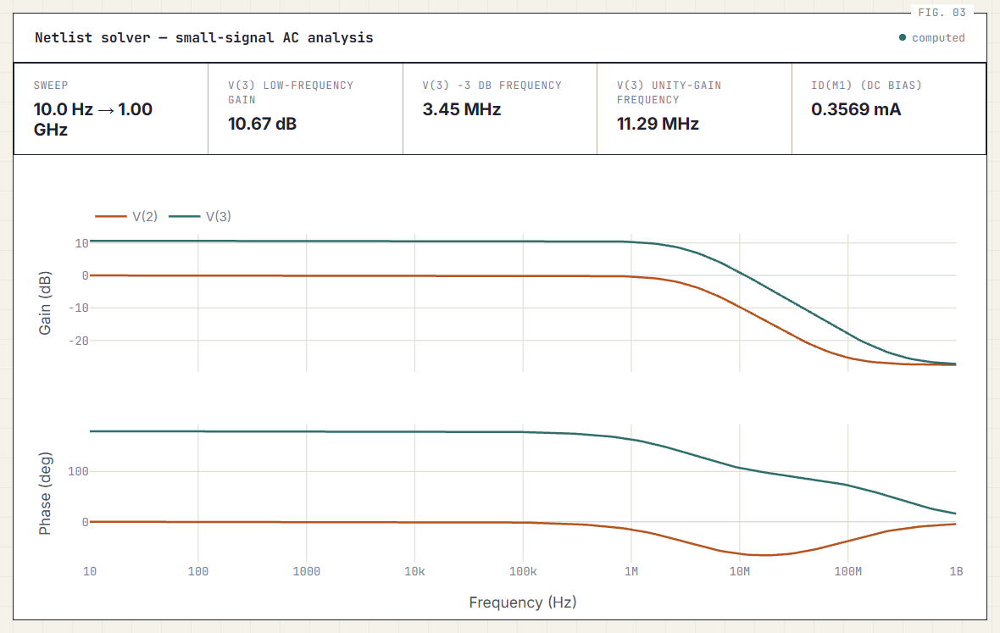

# AnalogSim

A small SPICE-style analog circuit simulator with a web front end, built from first principles in Python/NumPy.
It solves circuits by **Modified Nodal Analysis (MNA)**, handles nonlinear MOSFETs with **Newton-Raphson**, and
runs **DC operating point, DC sweep, and small-signal AC** analyses. Results are cross-checked against **ngspice**.

It also keeps a device-level lab: single-MOSFET I-V sweeps at three model fidelities (ideal, non-ideal, and
empirical data from a Postgres database).

## What it can do

| Analysis | Netlist directive | Method |
|---|---|---|
| DC operating point | `.op` (or none) | MNA; Newton-Raphson when a MOSFET is present |
| DC sweep | `.dc Vin 0 1.8 0.05` | Newton-Raphson with continuation (each point starts from the previous solution) |
| Small-signal AC | `.ac dec 20 10 1meg` | Linearize at the DC operating point, solve `(G + jwC)x = b` per frequency |

Elements: resistor `R`, capacitor `C`, independent voltage/current sources `V`/`I` (with `AC <mag>`), and
4-terminal NMOS/PMOS `M` (square-law + body effect + channel-length modulation, optional velocity saturation and
temperature-dependent mobility).

The web page plots DC sweeps (e.g. a CMOS inverter voltage-transfer curve) and AC results as a Bode plot with
low-frequency gain, -3 dB frequency, and unity-gain frequency.



## Netlist syntax

```
* comments start with *
Vin 1 0 0.8 AC 1        voltage source: DC 0.8 V, AC magnitude 1   (also: Vin 1 0 DC 0.8 AC 1)
Iload 0 2 1m             current source (SPICE convention: flows 0 -> source -> 2)
R1 1 2 1k                resistor
C1 2 0 100n              capacitor (open circuit at DC)
M1 d g s b NMOS W=2 L=180 [TOX= VTH0= GAMMA= LAMBDA= CGS= CGD=]
.dc Vin 0 1.8 0.05       DC sweep
.ac dec 20 10 1meg       AC sweep (dec = points per decade, or: lin N start stop)
.op / .end
```

Nodes are integers, `0` is ground. Numbers accept SPICE suffixes (`f p n u m k meg g t`; `m` is milli).
MOSFET `W` is in um and `L` in nm. `CGS`/`CGD` (farads) are used only by AC analysis.

Examples:

```
* CMOS inverter transfer curve          * RC low-pass, corner 1.59 kHz
Vdd 1 0 1.8                             Vin 1 0 0 AC 1
Vin 2 0 0                               R1 1 2 1k
M1 3 2 0 0 NMOS                         C1 2 0 100n
M2 3 2 1 1 PMOS                         .ac dec 20 10 1meg
.dc Vin 0 1.8 0.05
```

## Run it

Requires Python 3.10+ and a running PostgreSQL server. The API creates its tables on startup, so it will not
start without a reachable database. Create an empty database named `analogsim` first.

```powershell
cd apps\api
python -m venv .venv
.venv\Scripts\Activate.ps1          # macOS/Linux: source .venv/bin/activate
pip install -r requirements.txt
copy ..\..\.env.example .env         # macOS/Linux: cp ../../.env.example .env
# edit .env and set DATABASE_URL
python seed_data.py                  # sample "measured" data for the empirical engine
python -m uvicorn app.main:app --host 127.0.0.1 --port 8000
```

If PowerShell blocks the activate script, run `Set-ExecutionPolicy -Scope Process -ExecutionPolicy Bypass` first.

Then open `apps/api/app/frontend/index.html` in a browser (it talks to `http://127.0.0.1:8000`).
The netlist solver does not read any data from the database; it only needs the server to be able to start.

API: `POST /api/v1/solve_circuit` with `{"netlist": "..."}` returns `mode: "op" | "dc_sweep" | "ac"`;
`POST /api/v1/simulate` runs the single-device engines.

## Tests and validation

```bash
cd apps/api
python -m pytest -q          # 22 unit tests: closed-form circuits, MOSFET model, parser, AC theory
python validate_mna.py       # linear MNA vs hand calculations
python validate_nonlinear.py # Newton-Raphson / DC sweep vs independent bisection reference
python validate_ac.py        # AC analysis vs ngspice (needs ngspice on PATH)
```

Cross-check against ngspice (LEVEL 1 MOSFET):

| Check | Result |
|---|---|
| MNA solver vs `.op` on a resistor divider | exact match |
| Ideal engine vs LEVEL 1 | within 0.1% (small smoothing artifact at the triode/saturation boundary) |
| Non-ideal engine with CLM vs LEVEL 1 | exact in saturation; 6.46% max in triode (see below) |
| Non-ideal engine with body effect vs LEVEL 1 | exact match |
| AC: RC low-pass, 10 Hz-100 MHz | < 1e-6 dB, < 1e-6 deg |
| AC: common-source amp with Rs and Cgd (Miller pole) | < 1e-5 dB, < 1e-5 deg |

## Design decisions

- **Channel-length modulation is applied in saturation only.** ngspice LEVEL 1 applies `(1 + lambda*Vds)` in the
  triode region too, as a simplification. This project follows the physical origin of the effect (pinch-off), so it
  differs from ngspice by up to 6.46% in triode when CLM is on. The AC validation uses `LAMBDA=0` on both sides to
  isolate gm and capacitance behaviour from this known difference.
- **Jacobian by central differences** on the current function itself, so Newton-Raphson and the small-signal
  `gm`, `gds`, `gmb` always match whatever model options are enabled.
- **`GMIN` (1e-12 S) from every node to ground**, as in SPICE, so a cut-off device never leaves a node floating.
  It shifts AC results by ~1e-9 relative.

## Limitations

No inductors, diodes, BJTs, or transient analysis. MOSFET capacitances are user-specified constants
(`CGS`, `CGD`), not a bias-dependent Meyer model. Nodes are integers, not names. The MOSFET model is a
long-channel square-law model with first-order corrections, not BSIM.

The "raw silicon data" used by the empirical engine is synthetic: `seed_data.py` generates a noisy square-law
curve. The interpolation and scaling pipeline is real, but it only reflects actual silicon once you replace the
seed rows with lab measurements.

## Legacy

`index.html`, `app.js`, `styles.css`, and `data/` at the repository root are the original static prototype
(NMOS curve estimate and experimental-data viewer). The active application is `apps/api`.

## License

MIT
